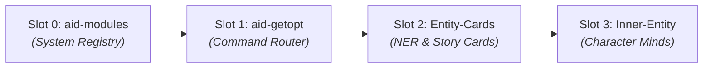

# Dynamic Slot Management & Graceful Degradation Guide 🎛️
### *A Practical Guide for Scenario Creators and Adventure Players*

In AI Dungeon **Adventure Mode**, players and scenario creators can attach multiple scripts to an adventure via the Script Manager. At any point during a game, scripts can be **toggled ON or OFF**, **reordered**, **added**, or **removed**.

This guide explains how the modular ecosystem (**AID-Modules**, **AID-Getopt**, **Entity-Cards**, and **Inner-Entity**) handles slot deactivation, dynamic reordering, and graceful degradation with **zero crashes, zero lost data, and zero single points of failure**.

---

## 1. Quick Answer: Can I Turn Off a Slot Mid-Adventure?

> **YES. Toggling off or removing any slot is 100% safe.**  
> - **No crashes:** Surviving scripts detect missing companions and fall back to standalone modes automatically.
> - **No lost data:** Disabling a script pauses future creation, but **never deletes** your existing Story Cards or character brain cards.
> - **Self-healing on the next turn:** If you turn a slot back on or reorder scripts, the ecosystem dynamically re-evaluates and adapts on the very next action.

---

## 2. The 4-Slot Architecture (Topology C)

When running the complete modular suite, the slots operate in an ordered pipeline:

| Slot | Script | Role & Primary Responsibility |
| :---: | :--- | :--- |
| **0** | **`aid-modules`** | Exposes `/aid-modules` to list active scripts, versions, and hosts the CSCP cross-slot discovery bus. |
| **1** | **`aid-getopt`** | Master command router that unifies all slash commands into an aggregated `/help` directory and provides developer diagnostics (`/aid-getopt`). |
| **2** | **`Entity-Cards`** | Autonomous Named Entity Recognition (NER), generating token-calibrated YAML cards for People, Places, Factions, Relics, and Events (`/ec`). |
| **3** | **`Inner-Entity (Minds)`** | Character cognition, private NPC goals, internal monologues, secrets, and reflection badges (`/ie`). |

---

## 3. What Happens When Slots Are Deactivated?

### Case 1: Slot 0 (`aid-modules`) is turned OFF
* **What pauses:**
  * The `/aid-modules -v` command will no longer respond.
  * Centralized CSCP registration stops being actively refreshed in `storyCards`.
* **What continues working:**
  * **All core gameplay functions normally.**
  * Slots 1, 2, and 3 call `loadCSCP()`, which safely returns `null` without throwing errors.
  * `Entity-Cards` and `Inner-Entity` automatically fall back to direct `storyCards` inspection (zero-width stamps on control card keys) to detect each other and prevent double-engine collisions.
  * Story card generation, NPC mind simulation, and all `/ec` and `/ie` commands run at 100% functionality.

---

### Case 2: Slot 1 (`aid-getopt`) is turned OFF
* **What pauses:**
  * The unified master `/help` directory (which combines all scripts into one menu) stops responding.
  * Standalone parser diagnostics (`/aid-getopt --diag`, `--test`) stop responding.
* **What continues working:**
  * **All gameplay commands (`/ec` and `/ie`) still work!**
  * **Why?** Both `Entity-Cards` and `Inner-Entity` have the getopt option parser **inlined directly into their code**.
  * `/ec <title> -<type>`, `/ec -a`, and `/ec -r` are handled natively by Slot 2.
  * `/ie -s`, `/ie -c`, and `/ie -i` are handled natively by Slot 3.
  * 3rd-person speech unwrapping (`> Jonathon says, "/ec -p brenner"`) continues working smoothly in both scripts.

---

### Case 3: Slot 2 (`Entity-Cards`) is turned OFF
* **What pauses:**
  * Automatic lorebook generation and Named Entity Recognition stop.
  * `/ec` commands will no longer generate cards (they pass through as normal story narration).
* **What continues working:**
  * **All existing Story Cards are preserved.** Previously generated characters, places, and lore stay in your adventure.
  * Slot 3 (`Inner-Entity`) continues running NPC cognition, monologue formation, and reflection badges (`🎭`).
  * If Slot 0 and 1 are active, `/aid-modules -v` and `/help` automatically detect that `entity-cards` is absent and remove it from the active command listing.

---

### Case 4: Slot 3 (`Inner-Entity Minds-Only`) is turned OFF
* **What pauses:**
  * Character mind simulation, private thoughts, and reflection badges (`🎭`) pause.
* **What continues working:**
  * **All existing NPC brain cards are preserved.** Any thoughts previously formed remain in the story cards list.
  * Slot 2 (`Entity-Cards`) continues monitoring story turns and generating lorebook cards.
  * System diagnostics update on the next turn to show minds simulation is inactive.

---

### Case 5: Turning OFF Both Utility Slots (Slots 0 & 1)
* **Result:** Deactivating both utility scripts instantly transforms the adventure into **Topology B (The Standard Modular Pair)**:
  * **Slot 1:** `Entity-Cards`
  * **Slot 2:** `Inner-Entity (Minds-Only)`
* This is the recommended lightweight modular setup: zero utility overhead, with both core gameplay engines coordinating directly across VM boundaries.

---

## 4. Deactivation & Impact Matrix

| Deactivated Component | Direct Impact on Adventure | Surviving Components Status | Data Safety |
| :--- | :--- | :--- | :--- |
| **Slot 0 (`aid-modules`)** | No `/aid-modules` command; CSCP bus pauses | **100% Functional:** Scripts fall back to direct card checks | All Cards Preserved |
| **Slot 1 (`aid-getopt`)** | Master `/help` menu pauses | **100% Functional:** `/ec` and `/ie` continue via inlined parsers | All Cards Preserved |
| **Slot 2 (`Entity-Cards`)** | Lore card generation pauses | **100% Functional:** Character minds & monologues continue | All Cards Preserved |
| **Slot 3 (`Inner-Entity`)** | NPC mind simulation pauses | **100% Functional:** Lore card generation continues | All Brains Preserved |
| **Slots 0 & 1** | Utility tools removed | **Seamless:** Becomes standard 2-slot pair (Topology B) | All Cards Preserved |

---

## 5. Architectural Resilience: Why Scripts Never Crash

The ecosystem achieves resilience through four design principles:

1. **Defensive Hydration (`loadCSCP()`):**  
   If the CSCP carrier card is missing or disabled, `loadCSCP()` returns `null` instead of raising exceptions. Every caller checks `if (cscp) ...` before interacting with the protocol.
2. **Inlined Parsers:**  
   Neither `Entity-Cards` nor `Inner-Entity` requires an external router to parse POSIX/GNU flags (`-p`, `-s`, `--abort`) or unwrap 3rd-person dialogue.
3. **Non-Destructive Persistence:**  
   Card creation code only runs on active generation events. Deactivating a script simply stops new additions; it never issues delete commands against existing story cards.
4. **Self-Healing State:**  
   Every script evaluates its environment at the start of each turn. If a duplicate slot is removed or an upstream slot is reordered, the script immediately clears its bypass flags and resumes normal operation.

---

## 6. Practical Tips for Players & Creators

* **Troubleshooting Collisions:**  
  If you ever see a `[DOUBLE ENGINE DETECTED]` warning in `/ec -i` or `/ie -i`, you accidentally loaded both `Entity-Cards` and `All-in-One Inner-Entity`. Simply disable one of them or replace the All-in-One slot with `inner-self-minds-only.js`. The warning will disappear on the very next turn.
* **Saving Memory on Mobile:**  
  If you are playing on mobile or memory-constrained devices, disable Slots 0 and 1. Running just Slot 2 (`Entity-Cards`) and Slot 3 (`Inner-Entity Minds-Only`) cuts the script footprint by ~100 KB while retaining all gameplay features.
* **Live Reordering:**  
  You can drag and drop script slots mid-game. Whichever card engine executes first automatically claims primary ownership; downstream duplicates yield and run in minds-only mode.
